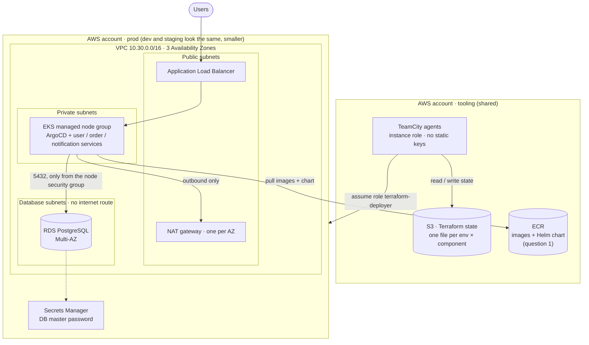
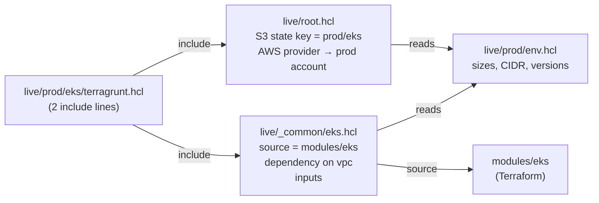
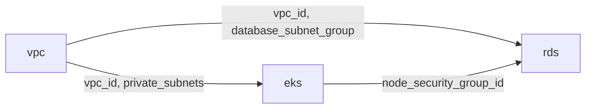
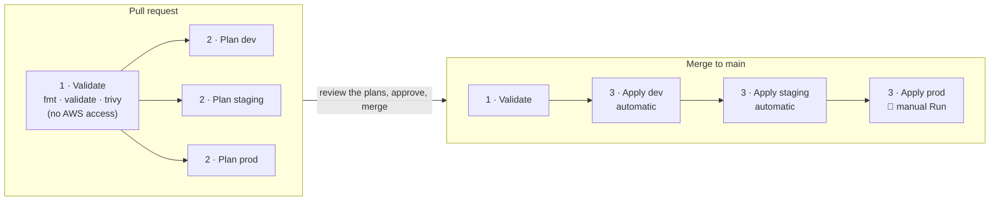

# Question 2: Infrastructure as Code

> **Assignment:** *"Demonstrate how you would provision infrastructure using Terraform or an
> equivalent Infrastructure as Code solution."*

**Answer:** three layers, each with one job:

| Layer | Answers the question | Where |
|---|---|---|
| **Terraform modules** | **What** gets built: a network, a Kubernetes cluster, a database | [`modules/`](modules) |
| **Terragrunt** | **Where**, and **with which settings**: dev / staging / prod, one state per component, the right order | [`live/`](live) |
| **TeamCity** | **When and by whom** it's applied: plan on PR, automatic dev → staging, manual prod | [`.teamcity/settings.kts`](.teamcity/settings.kts) |

This repo is kept deliberately **simple, to show the idea**. The account IDs are placeholders and
nothing has been applied to AWS. The modules, Terragrunt config and dependency graph were
validated locally (see [Validation](#10-validation)).

Related repos (question 1):
- [SqopeAI](https://github.com/gologolo24/SqopeAI): the services and their CI
- [SqopeAI-gitops-dev](https://github.com/gologolo24/SqopeAI-gitops-dev): what ArgoCD deploys

---

## Contents
1. [Architecture](#1-architecture)
2. [Repository layout](#2-repository-layout)
3. [Modules: what gets built](#3-modules-what-gets-built)
4. [Terragrunt: environments, state, order](#4-terragrunt-environments-state-order)
5. [How dev, staging and prod differ](#5-how-dev-staging-and-prod-differ)
6. [TeamCity: how changes reach AWS](#6-teamcity-how-changes-reach-aws)
7. [Security](#7-security)
8. [How to use it](#8-how-to-use-it)
9. [Not included (on purpose) and next steps](#9-not-included-on-purpose-and-next-steps)
10. [Validation](#10-validation)

---

## 1. Architecture

**One AWS account per environment** (dev, staging, prod), each with the same layout, plus a
shared **tooling** account where CI runs and the Terraform state lives.



| Design choice | Why |
|---|---|
| **Account per environment** | The strongest isolation AWS offers: a mistake or breach in dev can't touch prod, and costs and permissions are separated |
| **3 Availability Zones** | Losing one AZ (a whole data centre) doesn't take the platform down |
| **Three subnet tiers** | Only load balancers are public. Nodes are private (outbound through NAT only). The database has **no internet route at all**. |
| **Database reachable only from EKS nodes** | The security group references the node security group, not an IP range, so nothing else in the VPC can connect |
| **State in a separate tooling account** | People who can change prod resources can't tamper with the state history, and the reverse also holds |

---

## 2. Repository layout

```
modules/                      WHAT: reusable building blocks (thin wrappers over terraform-aws-modules)
  vpc/                        network: 3 AZs × public / private / database subnets, NAT, flow logs
  eks/                        Kubernetes: EKS cluster, managed node group, core add-ons
  rds/                        database: PostgreSQL + a security group that only allows EKS nodes
live/                         WHERE: one folder per environment, one folder per component
  root.hcl                    shared by all 9 units: S3 state settings + generated AWS provider
  _common/                    how each component is wired (source, dependencies, inputs), written ONCE
    vpc.hcl  eks.hcl  rds.hcl
  dev/
    env.hcl                   ← the ONLY place dev differs from the other environments
    vpc/terragrunt.hcl        ← a "unit": its own state, applied on its own
    eks/terragrunt.hcl
    rds/terragrunt.hcl
  staging/   (same layout)
  prod/      (same layout)
.teamcity/settings.kts        WHEN: the TeamCity pipeline as code (Kotlin DSL)
.trivyignore                  accepted security findings, each with a reason and an expiry date
```

---

## 3. Modules: what gets built

| Module | Creates | Key decisions | Code |
|---|---|---|---|
| **vpc** | VPC across 3 AZs: public /24, private /20 and database /24 subnets (computed with `cidrsubnet`), NAT, VPC flow logs | NAT mode per environment (one shared NAT in dev to save money, one per AZ elsewhere for HA). Subnets are tagged so Kubernetes load balancers land in the right place. | [modules/vpc](modules/vpc/main.tf) |
| **eks** | EKS cluster, managed node group (AL2023), add-ons: VPC CNI, CoreDNS, kube-proxy, Pod Identity agent | Nodes in private subnets. The API is public only to allow-listed CIDRs. Audit logs are on. Pod Identity lets pods get AWS permissions without keys. | [modules/eks](modules/eks/main.tf) |
| **rds** | PostgreSQL 17, a security group, encrypted storage with autoscaling | **The password is generated by AWS and kept in Secrets Manager** (`manage_master_user_password`), so it's never in code, state outputs or CI. Port 5432 is open only to the EKS node security group. | [modules/rds](modules/rds/main.tf) |

**Why wrap the community modules instead of writing every resource by hand?**
[terraform-aws-modules](https://github.com/terraform-aws-modules) are maintained and used by
thousands of companies, so there's no need to reinvent them. Our thin wrapper:
- **pins an exact version** (`6.9.0`, `21.30.2`, `7.2.2`), so upgrades are deliberate
- exposes **only the handful of inputs we want to vary** per environment
- **bakes in Sqope standards** that nobody can forget: flow logs, private nodes, database access
  by security group only, the password in Secrets Manager

> At larger scale the modules would live in their own repo and be referenced by git tag
> (`?ref=v1.4.0`). That way prod can stay on a tested module version while dev tries the next
> one. Here they're referenced by local path to keep things simple.

---

## 4. Terragrunt: environments, state, order

Plain Terraform makes you copy backend and provider config, and wire outputs to inputs, in every
environment folder. Terragrunt removes that repetition:

### How one unit is assembled



A unit file is just two `include` lines ([example](live/prod/eks/terragrunt.hcl)). Everything else
is written once:
- [`root.hcl`](live/root.hcl) generates the S3 backend and the AWS provider for every unit.
- [`_common/eks.hcl`](live/_common/eks.hcl) says *which module*, *what it depends on* and *which
  inputs it gets*.
- [`env.hcl`](live/prod/env.hcl) holds the values.

### One state per environment × component

| | vpc | eks | rds |
|---|---|---|---|
| **dev** | `dev/vpc/terraform.tfstate` | `dev/eks/terraform.tfstate` | `dev/rds/terraform.tfstate` |
| **staging** | `staging/vpc/…` | `staging/eks/…` | `staging/rds/…` |
| **prod** | `prod/vpc/…` | `prod/eks/…` | `prod/rds/…` |

The key is computed, never typed: `key = "${path_relative_to_include()}/terraform.tfstate"`
([root.hcl](live/root.hcl)).

**Why separate states?**
- **Small blast radius.** A bad change to the cluster can't touch the database's state, and a dev
  change can't touch prod.
- **Speed.** A plan for `rds` refreshes about 10 resources, not the whole environment.
- **Locking per component.** Two people can work on dev `eks` and dev `rds` at the same time.
  Locking uses S3's native lock files, so no DynamoDB table is needed.
- **Permissions per component** become possible, e.g. a DBA team that can apply only `rds`.

### Dependencies and order



- `dependency` blocks ([eks.hcl](live/_common/eks.hcl), [rds.hcl](live/_common/rds.hcl)) read
  another component's **outputs from its state**, so nothing is copy-pasted between components.
- `terragrunt run --all apply` works out the order (vpc → eks → rds) and runs independent units
  in parallel. `destroy` runs in reverse.
- `mock_outputs` let a brand-new environment be **planned before anything exists** (the first
  plan of eks uses placeholder VPC IDs).

---

## 5. How dev, staging and prod differ

Everything that differs between environments lives in one small file per environment:
[dev](live/dev/env.hcl) · [staging](live/staging/env.hcl) · [prod](live/prod/env.hcl).

| Setting | dev | staging | prod | Why |
|---|---|---|---|---|
| AWS account | 111111111111 | 222222222222 | 333333333333 | Isolation (placeholders) |
| VPC CIDR | 10.10.0.0/16 | 10.20.0.0/16 | 10.30.0.0/16 | Non-overlapping, so VPCs can be peered later |
| NAT gateways | 1 shared | 1 per AZ | 1 per AZ | Dev saves cost; staging and prod survive an AZ outage |
| EKS nodes | t3.large **SPOT**, 2-4 | m6i.large, 2-4 | m6i.xlarge, **3-10** | Dev is about 70% cheaper on spot; prod has capacity in every AZ |
| RDS | db.t4g.micro, single-AZ | db.t4g.medium, **Multi-AZ** | db.r7g.large, **Multi-AZ** | Prod gets automatic failover |
| Backups | 1 day | 7 days | **30 days** | Recovery window grows with importance |
| Deletion protection | off | **on** | **on** | Dev can be torn down; the others can't be deleted by accident |

**Staging has the same topology as prod at a smaller size**, so problems that only appear in a
highly available setup are caught before prod.

---

## 6. TeamCity: how changes reach AWS

The pipeline is code ([`.teamcity/settings.kts`](.teamcity/settings.kts), Kotlin DSL), versioned
and reviewed like everything else.



| Stage | What it does | AWS role | Trigger |
|---|---|---|---|
| **1 · Validate** | `terraform fmt -check`, `terragrunt hcl fmt --check`, `terraform validate` per module, `terragrunt hcl validate`, `trivy config` (fails on HIGH/CRITICAL) | **none** | Every branch and PR |
| **2 · Plan dev / staging / prod** | `terragrunt run --all plan` per environment, in parallel. The plan is saved as an artifact and the status is posted to the PR. **Reviewers see the effect on prod before merging.** | `terraform-planner` (read-only) | Pull requests |
| **3 · Apply dev** | `terragrunt run --all apply`, in dependency order | `terraform-deployer` | Merge to `main` |
| **3 · Apply staging** | Same, once dev succeeded | `terraform-deployer` | Automatically after dev |
| **3 · Apply prod** | Same | `terraform-deployer` | **Manual**: a human clicks *Run* after reviewing the prod plan |

**Promotion guarantees:**
- **Same commit everywhere.** Snapshot dependencies chain the apply builds, so prod applies
  exactly the commit that already succeeded in dev and staging.
- **One apply at a time per environment** (`maxRunningBuilds = 1`), on top of state locking.
- **Applies never run from a PR branch** (`branchFilter = "+:<default>"`).
- **PRs from outsiders don't run** (public repo): only organization members' PRs are built.
- **Written once.** The three apply builds come from one Kotlin function, `applyBuild(env)`.

> **Optimization for later:** `terragrunt run --all --filter-affected` plans only the components
> a PR actually changed.

---

## 7. Security

| Concern | How it's handled |
|---|---|
| **No static AWS keys** | TeamCity agents use an instance role in the tooling account and **assume a role** in each environment account. Engineers do the same through SSO. ([root.hcl](live/root.hcl)) |
| **Least privilege for CI** | PR plans use the read-only `terraform-planner` role. Only the apply builds on `main` get `terraform-deployer` (`TF_ROLE_NAME`). |
| **Wrong-account protection** | `allowed_account_ids` in the generated provider: a dev unit **refuses to run** with prod credentials and vice versa |
| **State** | S3 with encryption and versioning (every state change can be recovered), in a separate account, with native locking |
| **Database password** | Generated by AWS and stored in Secrets Manager. Never in git, variables, CI logs or Terraform outputs. In-cluster it's read through External Secrets. |
| **Network** | Private nodes, a database with no internet route, DB access by security group reference, the EKS API limited to allow-listed CIDRs, VPC flow logs |
| **Encryption** | RDS storage encrypted. EKS secrets are encrypted with KMS (module default). |
| **Audit** | EKS control-plane audit logs and VPC flow logs to CloudWatch. Every change is a reviewed PR with a saved plan. |
| **Code scanning** | `trivy config` on every PR. Accepted findings are recorded in [`.trivyignore`](.trivyignore) **with a reason, an owner and an expiry date**, not silently ignored. |
| **Tagging** | `default_tags` on every resource: Project, Environment, Component, ManagedBy, Repository. Useful for cost reports and for finding the code behind any resource. |

---

## 8. How to use it

```bash
# plan a whole environment (Terragrunt orders vpc → eks → rds)
terragrunt run --all --working-dir live/dev -- plan

# work on a single component
cd live/dev/eks && terragrunt plan

# see the dependency graph
terragrunt dag graph --working-dir live

# see the final resolved config of a unit (inputs, state key, module source)
cd live/prod/rds && terragrunt render
```

| Task | How |
|---|---|
| Resize prod nodes | Edit `live/prod/env.hcl`, open a PR, review the **Plan prod** output, merge, then click **Apply prod** |
| Add an environment (e.g. `qa`) | Copy `live/staging/`, edit its `env.hcl` (new account, CIDR, sizes). No other file changes. |
| Add a component (e.g. `redis`) | Add `modules/redis`, `live/_common/redis.hcl`, and a two-line unit file per environment |

**One-time prerequisites** (account baseline, done once and outside this repo):
- AWS Organizations with the accounts
- the `terraform-planner` and `terraform-deployer` roles in each environment account, trusting
  the tooling account
- the state bucket (`terragrunt backend bootstrap` can create it)

---

## 9. Not included (on purpose) and next steps

Kept out to keep the example focused on the three requested components:

| Next component | What it adds |
|---|---|
| `live/shared/ecr` | ECR repositories + the **GitHub OIDC role** that the SqopeAI pipeline needs to push images (question 1) |
| `live/<env>/platform` | Installs **ArgoCD**, **External Secrets Operator** and the **AWS Load Balancer Controller** via the Helm provider, then applies the [GitOps root app](https://github.com/gologolo24/SqopeAI-gitops-dev/blob/main/bootstrap/root-app.yaml) |
| Private EKS API | VPN / Transit Gateway, then turn the public endpoint off (tracked in `.trivyignore`) |
| VPC endpoints | ECR, S3 and STS endpoints: less NAT traffic and tighter egress |

Monitoring (question 5) and disaster recovery (question 6) build on this layout.

---

## 10. Validation

What was checked locally (nothing was applied, and there's no AWS account):

| Check | Result |
|---|---|
| `terraform fmt -check` + `terraform validate` on all 3 modules | ✅ valid against the pinned community module versions |
| `trivy config` (HIGH/CRITICAL) | ✅ passes. 2 accepted findings documented in `.trivyignore` |
| `terragrunt hcl fmt --check` + `terragrunt hcl validate` | ✅ |
| `terragrunt dag graph` | ✅ vpc → eks → rds in each environment, environments independent |
| `terragrunt render` for `prod/rds` | ✅ state key `prod/rds/terraform.tfstate`, prod values, mocked dependency outputs |
| TeamCity Kotlin DSL | Not compiled locally (no JVM). TeamCity compiles and validates it when it imports versioned settings. |
